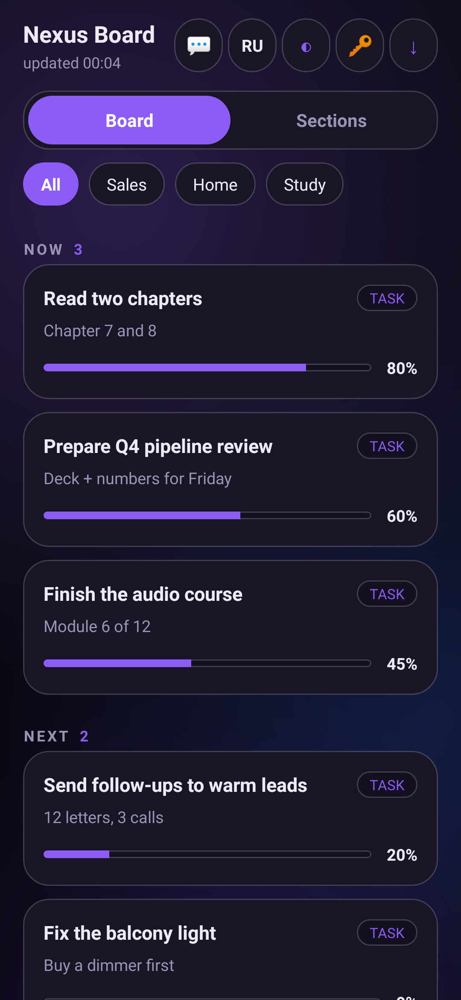
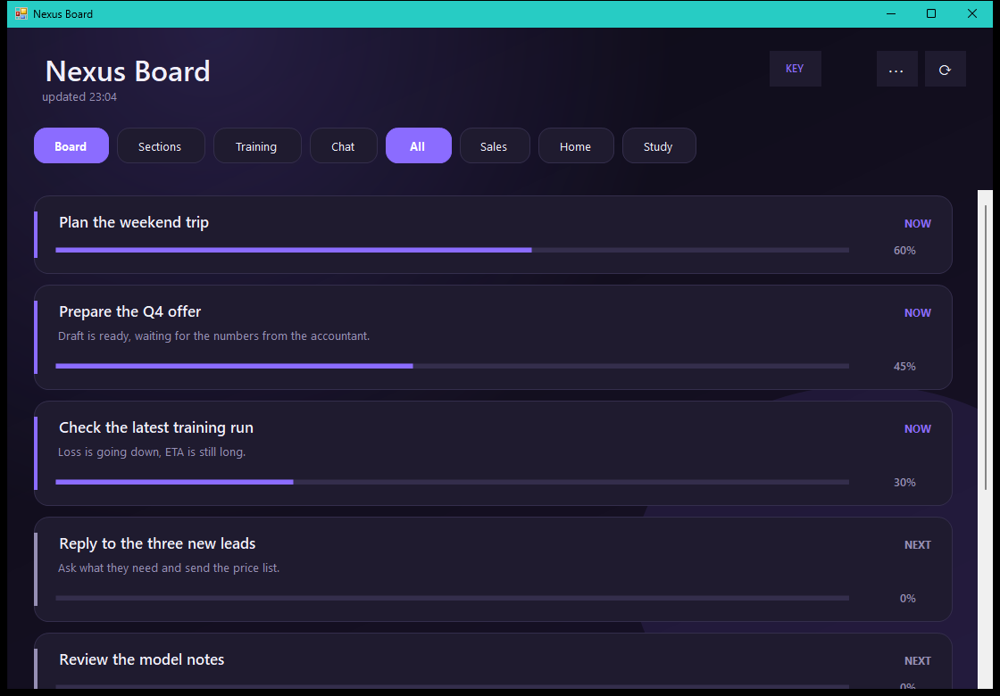
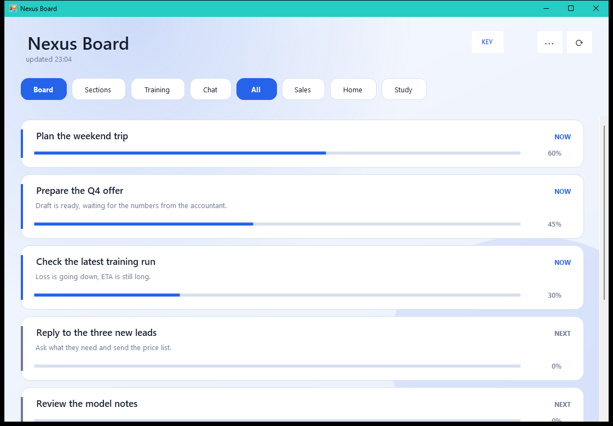
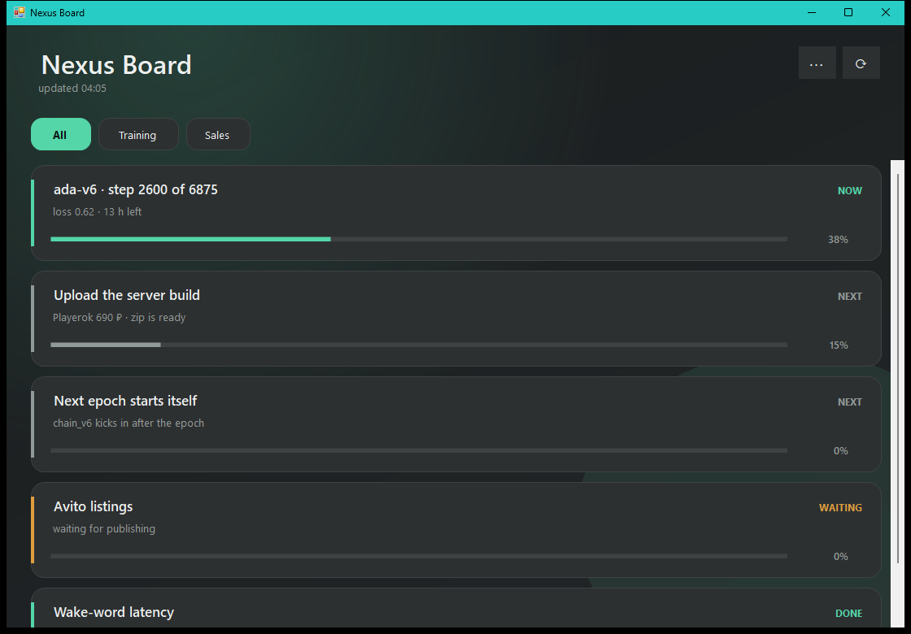
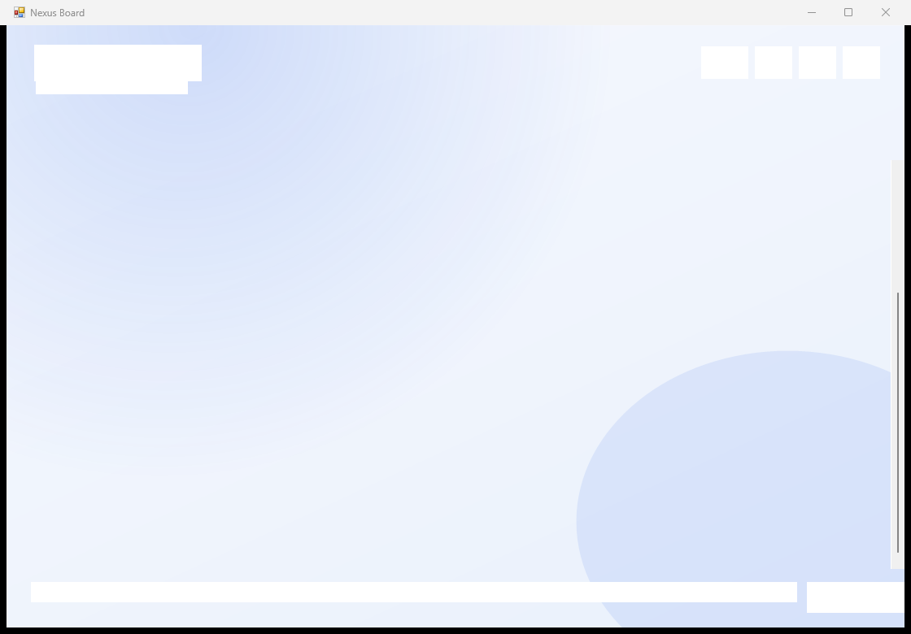
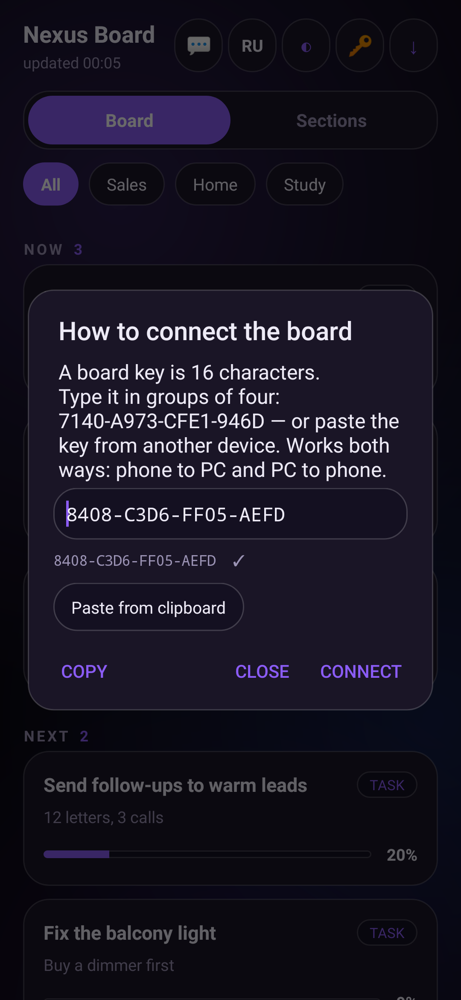

# Nexus Board 📋

A task board that **your own AI** fills in. Phone and PC are linked by one key and show the same board, and the data travels over a plain website — so it works in any network, not only at home.

Nexus × АутSquad · RU/EN · three themes · no accounts, no subscriptions




| Midnight | Frost | Graphite |
|---|---|---|
|  |  |  |

## How it works

1. Install the app on your phone and/or PC.
2. On first launch a **personal board** is created and its 16-character key is shown.
3. Paste the same key into the second app (on the phone: long-press the title, “Board key”).
4. From then on your AI fills the board: it creates section tabs and tasks with plain HTTP requests.

No sign-up, no password, no link to our account: the key is the only thing connecting your devices.

## Three ways to install on PC

| File | What it is |
|---|---|
| `NexusBoard.exe` | Portable build, installs nothing |
| `NexusBoard-portable-2.0.2.zip` | The same plus a README |
| `NexusBoard-setup.exe` | Installer: copies to `%LOCALAPPDATA%\NexusBoard`, creates desktop and Start menu shortcuts, adds an entry to “Add or remove programs” |

Windows 7+ and .NET Framework 4.7+ (already present in Windows 10/11). When a new version ships, an update button appears in the header.

## Phone

Android 7+. The APK updates itself; the board and training screens refresh every 10 seconds while the app is open.

## What it does

- **Sections the AI builds itself** — not just tasks: a metric with a caption, a progress bar, status lights, text, **the tail of any log file on the PC** (the server reads the file), links, a chart, and **code**. One CLI call adds a section and it shows up on the PC, the phone and the site at once. A client that does not know a kind simply skips it: nothing breaks, nothing is deleted.
- **Code from the PC to the phone** — a `code` block is pulled to the device, an edit can be pushed back with an optimistic version check (`409 conflict` instead of a silent overwrite).
- **Columns** Now / Next / Waiting / Done, notes, mode, percentages.
- **Section tabs** — “Training”, “Sales”, “Home”. Your AI creates them through the API or you add them with the “+ section” button; they appear on phone and PC at once.
- **Clean interface**: the main view is just the board and a `⋯` menu. F5 — refresh, Ctrl+N — new task, Ctrl+Alt+S — settings.
- **Three themes**: Midnight (black + violet), Frost (white + blue), Graphite (graphite + mint).
- **Russian and English** interface, the switch works instantly.
- **“Connect” screen** — both keys and a short guide, the key is copied with one click.
- **In-app updates** on both platforms.
- **Chat with your AI** (2.0.2): the 💬 button in the app header and the “Chat” tab on PC — messages go through the same server, replies arrive within a few seconds, history is kept per board.

## Connecting through our server

Public address: `https://board.nexus-your-heper.ru`. No account needed, only the board key.

**Option 1 — the board already exists.** The key is on the “Connect” screen (on the phone: long-press the “updated” line). Give that key to your AI or to the second app and it works with the same board.

**Option 2 — a board for a third-party client.** Any client creates its own:

```bash
curl -X POST https://board.nexus-your-heper.ru/api/b/new
# → {"ok":true,"id":"0123456789abcdef"}
```

All further requests carry that `id` in the `b` parameter:

```bash
# section tab
curl -X POST "https://board.nexus-your-heper.ru/api/b/section/add?b=<id>" \
  -H "Content-Type: application/json" -d '{"name":"Training"}'

# task (section — section id, optional)
curl -X POST "https://board.nexus-your-heper.ru/api/b/add?b=<id>" \
  -H "Content-Type: application/json" \
  -d '{"title":"ada-v6, step 2600","note":"loss 0.62","status":"doing","progress":38}'

# update, read, clear
curl -X POST "https://board.nexus-your-heper.ru/api/b/update?b=<id>" -d '{"id":"<taskId>","progress":60}'
curl "https://board.nexus-your-heper.ru/api/b/tasks?b=<id>"
curl "https://board.nexus-your-heper.ru/api/b/section?b=<id>"
curl -X POST "https://board.nexus-your-heper.ru/api/b/clear?b=<id>"
```

`status`: `todo` · `doing` · `blocked` · `done`. `mode`: `auto` · `task` · `night`. `progress`: 0–100. Limits: 200 tasks and 20 sections per board.

## Chat API

`POST /api/c/send` with `{"board":"<id>","from":"owner","text":"hi"}` and `GET /api/c/list?board=<id>&since=<ms>` keep the conversation. `from` is `owner` or `ai`; up to 500 messages are stored per board. Details: `docs/chat-api.md`.

## CLI inside the same exe

`NexusBoard.exe` doubles as the command-line client used by the AI:

```bash
NexusBoard.exe --add "text" --mode task --note "details"
NexusBoard.exe --start t6
NexusBoard.exe --progress t6 --to 40 --note "what is done"
NexusBoard.exe --done t6        # or --block t6 --note "why"
NexusBoard.exe --list [--json]
NexusBoard.exe --chat-list      # read the conversation
NexusBoard.exe --chat-say "reply"
```

## Build from source

- Android: `gradle assembleRelease` (Gradle 8.10, minSdk 24), APK in `app/build/outputs/apk/release/`.
- PC: `pc\build.cmd` (csc from .NET Framework 4.7), installer: `pc\setup\build.cmd`.
- Server: `node server/server.js` (port 8788, key in `server/token.txt`).

## Sections the AI builds

```bash
NexusBoard.exe --view-add "Training" --kind progress --body '{"value":82,"label":"ada-v6"}'
NexusBoard.exe --view-set <id> --body "@file.json" [--title ...] [--order 10] [--size md|wide]
NexusBoard.exe --view-del <id> / --view-list [--json]
NexusBoard.exe --code-push [<id>] --title "Patch" --file E:\patch.diff [--lang diff]
NexusBoard.exe --code-pull <id> [--out E:\patch.diff]
```

Kinds and the API: `docs/views.md`. Every CLI write is synced to the server (`/api/b/sync`), so the board
in the app and in scripts is the same one. Unknown kinds are skipped by clients — updates never break data.

## License

MIT — see [LICENSE](LICENSE).
## Chat with the AI and connecting by key

The conversation lives in the same app: 💬 in the phone header, the “Chat” tab on PC. Replies arrive on their own, history is kept per board key.

| Chat on PC | Key on the phone (paste from clipboard) |
|---|---|
|  |  |

The key can be pasted from the clipboard — the phone joins the PC board and the other way around.
