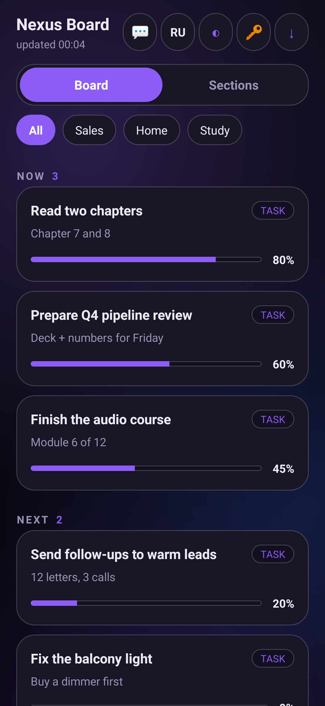
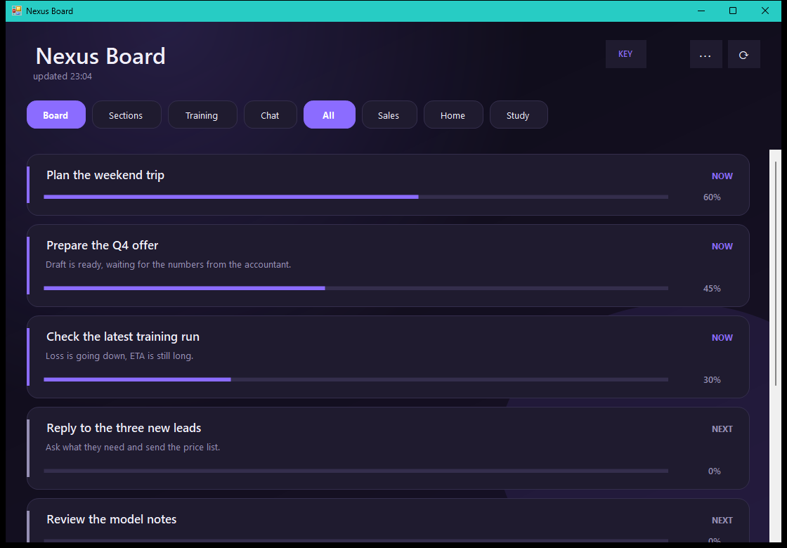
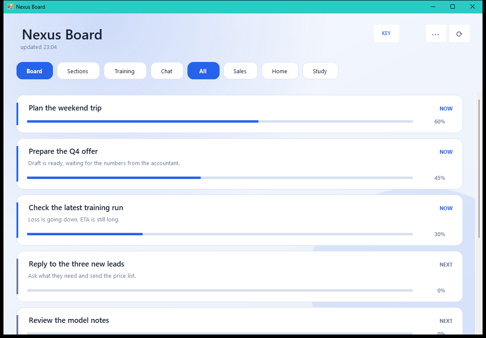
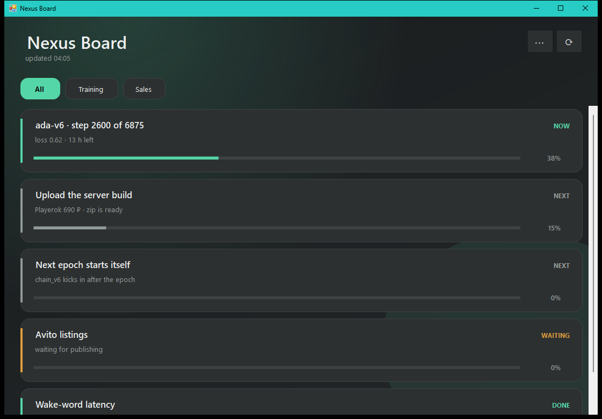
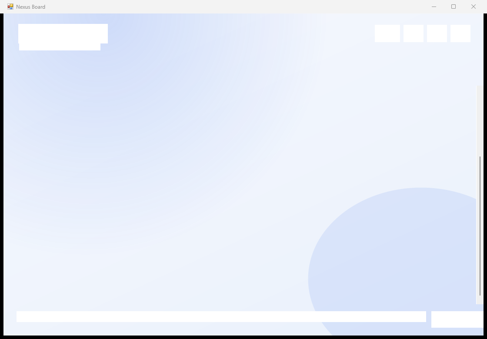
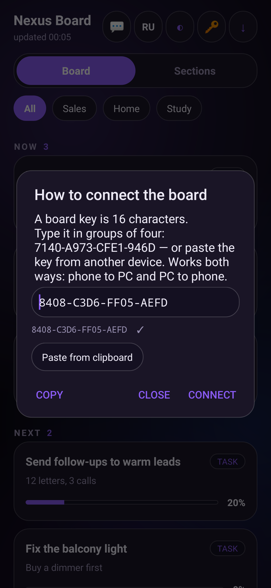

# Nexus Board 📋

Доска задач, которую заполняет **ваш собственный ИИ**. Телефон и компьютер связаны одним ключом и показывают одну доску, а данные идут через обычный сайт — поэтому работает не только дома, в любой сети.

Nexus × АутSquad · RU/EN · три темы · без аккаунтов и подписок




| Midnight | Frost | Graphite |
|---|---|---|
|  |  |  |

## Как это работает

1. Ставите приложение на телефон и/или ПК.
2. При первом запуске создаётся **личная доска** и показывается её ключ из 16 символов.
3. Вставляете этот же ключ во второе приложение (на телефоне — долгое нажатие по строке «обновлено» внизу, «Ключ доски»).
4. Дальше доску наполняет ваш ИИ: он создаёт разделы-вкладки и задачи обычными HTTP-запросами.

Ни регистрации, ни пароля, ни привязки к нашему аккаунту: ключ — единственное, что связывает устройства.

## Три способа установки на ПК

| Файл | Что это |
|---|---|
| `NexusBoard.exe` | Портативная сборка, ничего не устанавливает |
| `NexusBoard-portable.zip` | Она же плюс README |
| `NexusBoard-setup.exe` | Установщик: копирует в `%LOCALAPPDATA%\NexusBoard`, делает ярлыки на рабочем столе и в «Пуске», добавляет запись в «Удаление программ» |

Windows 10/11 и .NET Framework 4.8 (в Windows 10/11 уже есть). Кнопка обновления появляется в шапке только когда новая версия действительно есть, а скачанный файл проверяется по SHA-256 и подписи.

## Телефон

Android 13+ (`minSdk 33`). Доска и обучение обновляются каждые 10 секунд, пока приложение открыто; обновление APK предлагается вручную и проверяется по SHA-256.

## Что умеет

- **Разделы, которые ИИ создаёт сам** — не только задачи: число с подписью (`metric`), полоса прогресса (`progress`), светофоры состояния (`status`), текст (`text`), **хвост любого лога с ПК** (`log`, сервер сам читает файл), ссылки (`links`), график (`chart`), **код** (`code`). ИИ добавляет раздел одной командой — он сразу на ПК, на телефоне и на сайте. Клиент, который не знает тип, просто не рисует карточку: ничего не ломается и не удаляется.
- **Код с ПК на телефон** — блок `code` тянется на устройство (`GET /api/b/code`), правку можно отправить назад (`POST /api/b/code/save`) с проверкой версии: если на сервере уже новее, приходит `409 conflict`, а не тихая перезапись.
- **Колонки** Сейчас / Дальше / Ждёт / Готово, заметка, режим, проценты.
- **Разделы-вкладки** — «Обучение», «Продажи», «Дом». Их создаёт ИИ через API или человек кнопкой «+ раздел»; на телефоне и ПК появляются одновременно.
- **Чистый интерфейс**: в главном виде только доска и меню `⋯`. F5 — обновить, Ctrl+N — новая задача, Ctrl+Alt+S — настройки.
- **Три темы**: Полночь (чёрный + фиолетовый), Иней (белый + синий), Графит (графит + мята).
- **Русский и английский** интерфейс, переключатель работает сразу.
- **Экран «Подключение»** — те же ключи и короткая инструкция, ключ копируется одной кнопкой.
- **Обновление из приложения** на обеих платформах.

## Как подключиться через наш сервер

Публичный адрес: `https://board.nexus-your-heper.ru`. Аккаунт не нужен, нужен только ключ доски.

**Вариант 1 — доска уже создана приложением.** Ключ виден на экране «Подключение» (на телефоне — долгое нажатие по строке «обновлено»). Отдайте ключ своему ИИ или второй программе, и она работает с той же доской.

**Вариант 2 — доска для стороннего клиента.** Любой клиент создаёт себе доску сам:

```bash
curl -X POST https://board.nexus-your-heper.ru/api/b/new -H "Content-Type: application/json" -d '{"key":"придумайте-свой-секрет"}'
# → {"ok":true,"id":"<16 hex, ваш id>"}
```

Дальше все запросы идут с этим `id` в параметре `b`:

```bash
# раздел-вкладка
curl -X POST "https://board.nexus-your-heper.ru/api/b/section/add?b=<id>" \
  -H "Content-Type: application/json" -d '{"name":"Обучение"}'

# задача (section — id раздела, необязателен)
curl -X POST "https://board.nexus-your-heper.ru/api/b/add?b=<id>" \
  -H "Content-Type: application/json" \
  -d '{"title":"ada-v6, шаг 2600","note":"loss 0.62","status":"doing","progress":38}'

# обновить, прочитать, очистить
curl -X POST "https://board.nexus-your-heper.ru/api/b/update?b=<id>" -d '{"id":"<taskId>","progress":60}'
curl "https://board.nexus-your-heper.ru/api/b/tasks?b=<id>"
curl "https://board.nexus-your-heper.ru/api/b/section?b=<id>"
curl -X POST "https://board.nexus-your-heper.ru/api/b/clear?b=<id>"
```

`status`: `todo` · `doing` · `blocked` · `done`. `mode`: `auto` · `task` · `night`. `progress`: 0–100. Лимиты: 200 задач и 20 разделов на доску.

Ключ доски — это и есть авторизация: кто знает ключ, тот видит доску. Ничего другого сервер про пользователя не хранит, аналитики и трекинга нет, наружу отдаются только задачи и разделы.

**Вариант 3 — свой сервер.** Сервер лежит в этом же репозитории, папка `server`, без базы данных:

```bash
node server/server.js          # слушает 8788, доски в server/boards/*.json, задачи в data/tasks.json
NEXUS_SITE_PORT=9000 node server/server.js
```

В настройках приложения (ПК: `⋯` → Настройки, телефон: долгое нажатие по заголовку) замените адрес сервера на свой — `http://192.168.1.11:9000` в домашней сети или на адрес, куда вы его выставили. Остальное не меняется: `POST /api/b/new` создаст доску уже на вашем сервере.

## Прогресс и командная строка (бывший Nexus-Tasks)

`NexusBoard.exe` — не только окно. Тот же файл работает как CLI доски прогресса, отдельная утилита больше не нужна:

```
NexusBoard.exe --add "Текст задачи" --mode night --note "детали" --prio 1
NexusBoard.exe --start t6
NexusBoard.exe --progress t6 --to 40 --note "что сделано"
NexusBoard.exe --done t6            (или --block t6 --note "причина")
NexusBoard.exe --mode task          (idle | task | auto | night)
NexusBoard.exe --list               (--json для машинного чтения)

Разделы и код, которые ИИ пишет сам:
NexusBoard.exe --view-add "Обучение" --kind progress --body "{\"value\":82,\"label\":\"ada-v6\"}"
NexusBoard.exe --view-set <id> --body "@file.json" [--title ...] [--order 10] [--size md|wide]
NexusBoard.exe --view-del <id> / --view-list [--json]
NexusBoard.exe --code-push [<id>] --title "Патч" --file E:\patch.diff [--lang diff]
NexusBoard.exe --code-pull <id> [--out E:\patch.diff]
```

Виды разделов и API — `docs/views.md`. Любая CLI-запись автоматически уезжает на сервер (`/api/b/sync`), поэтому доска в приложении и в скриптах — одна и та же.

Данные — `data/tasks.json` рядом с программой, лента — `data/activity.ndjson`. Тот же `server/server.js` отдаёт их в браузер: `/api/tasks`, `/api/activity`, `/api/train`, `/api/health`. Одно приложение, один репозиторий, один установщик.

## Обучение (режим Nexus)

Если ввести ещё и ключ нашей доски Nexus, появляется вкладка «Обучение»: стадия, шаг, прогресс, loss, скорость, ETA, график и хвост лога цепочки — и на телефоне, и на ПК. У обычных пользователей её нет.

## English

**Nexus Board** is a task board your own AI fills in. Two platforms, one key: the Android app and the Windows build show the same board, and the data travels through a plain website, so it works outside your home network too.

1. Install the app on the phone and/or the PC.
2. On first launch a **personal board** is created and its 16-character key is shown.
3. Paste that key into the other app (phone: long-press the “updated” line at the bottom → board key field). Both now share one board.
4. Your AI fills it and creates section tabs through a tiny HTTP API.

**Three ways to install on PC:**

| File | What it is |
|---|---|
| `NexusBoard.exe` | Portable build. Run it, nothing is installed. |
| `NexusBoard-portable.zip` | Portable build plus README. |
| `NexusBoard-setup.exe` | Installer: copies to `%LOCALAPPDATA%\NexusBoard`, adds desktop and Start-menu shortcuts and an uninstall entry. |

Windows 10/11 with .NET Framework 4.8 (already present). The update button appears only when a newer build exists, and the downloaded file is checked against SHA-256 and the app signature.

Android 13+ (`minSdk 33`). The board refreshes every 10 seconds while the app is open; APK updates are offered manually and checked against SHA-256.

Features: section tabs (Training, Sales, Home — created by your AI or with “+ Section”), Now / Next / Waiting / Done columns with notes and progress, three named themes (Midnight, Frost, Graphite), Russian and English UI with an instant switch, a Connection screen with copyable keys, and one-click update on both platforms.

### Connecting through our server

Public endpoint: `https://board.nexus-your-heper.ru`. No account, only the board key.

A board is either created by the app (its key is on the Connection screen) or by any client:

```bash
curl -X POST https://board.nexus-your-heper.ru/api/b/new -H "Content-Type: application/json" -d '{"key":"придумайте-свой-секрет"}'
# → {"ok":true,"id":"<16 hex, ваш id>"}
```

Then use that `id` as the `b` parameter:

```bash
curl -X POST "https://board.nexus-your-heper.ru/api/b/section/add?b=<id>" \
  -H "Content-Type: application/json" -d '{"name":"Training"}'
curl -X POST "https://board.nexus-your-heper.ru/api/b/add?b=<id>" \
  -H "Content-Type: application/json" \
  -d '{"title":"step 2600","note":"loss 0.62","status":"doing","progress":38}'
curl -X POST "https://board.nexus-your-heper.ru/api/b/update?b=<id>" -d '{"id":"<taskId>","progress":60}'
curl "https://board.nexus-your-heper.ru/api/b/tasks?b=<id>"
curl "https://board.nexus-your-heper.ru/api/b/section?b=<id>"
curl -X POST "https://board.nexus-your-heper.ru/api/b/clear?b=<id>"
```

`status`: `todo` · `doing` · `blocked` · `done`. `mode`: `auto` · `task` · `night`. `progress`: 0–100. Limits: 200 tasks and 20 sections per board. The key is the whole authorisation: whoever knows it sees the board — keep it private and do not commit it to git. Nothing else about the user is stored, no tracking, only tasks and sections are served.

**Your own server:** the backend ships in this same repo, folder `server`, no database.

```bash
cd server
node server.js                          # port 8788, boards in server/boards/*.json
NEXUS_SITE_PORT=9000 node server.js
```

Site access uses a separate token in `server/token.txt` (or `NEXUS_SITE_TOKEN`); without it the site is open only to localhost.

Change the server address in the app settings (PC: `⋯` → Settings, phone: long-press the title) and everything else stays the same.
## Чат с ИИ и подключение ключом

Переписка живёт в том же приложении: на телефоне — кнопка 💬 в шапке, на ПК — вкладка «Чат». Ответы приходят сами, история хранится по ключу доски.

| Чат на ПК | Ключ на телефоне (вставка из буфера) |
|---|---|
|  |  |

Ключ можно вставить из буфера — телефон подключается к доске ПК и наоборот.
